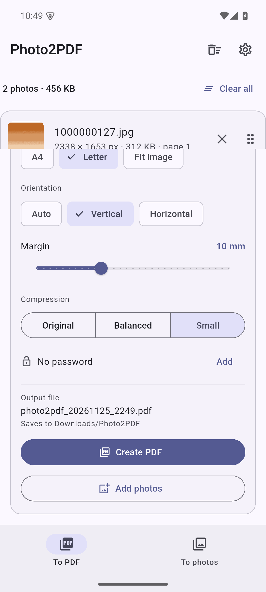

# Photo2PDF

Turn a pile of photos into one PDF — or a PDF back into photos. Runs on Android
and Linux, built with Flutter and Material 3, and does everything on the device:
nothing is uploaded anywhere.

 

## Two modes

**To PDF** — pick photos from the gallery or the file browser (or drop them
straight onto the desktop window), drag them into the order you want, and get a
single PDF.

On Linux and Windows the whole window becomes a drop target while a file is
held over it, and unsupported files are named back to you instead of silently
vanishing.

- Any format the system can decode: JPEG, PNG, WebP, BMP, HEIC, TIFF, GIF.
- Page size **A4**, **Letter**, or **Fit image** (the page takes the photo's own
  shape); orientation **Auto**, **Vertical** or **Horizontal**.
- Margin slider from 0 to 30 mm, and a live preview of what each page will look
  like.
- Compression: **Original** keeps a JPEG byte for byte and only rewrites other
  formats; **Balanced** (~2000 px, quality 80) and **Small** (~1200 px, quality
  70) are for sharing by mail. A 4032 × 3024 test photo went 1.26 MB → 0.50 MB →
  0.13 MB.
- Optional **password** (RC4 128-bit, the standard security handler), so the
  document asks for it in any reader: `qpdf --show-encryption` reports RC4
  128-bit on a PDF made here, and the wrong password is refused.
- EXIF orientation is applied, so phone photos are never sideways.
- The output name is suggested from the photos and the time, and is made unique
  (`scan (2).pdf`) rather than overwriting.

**To photos** — choose a PDF, pick a resolution, and every page comes out as a
JPEG.

- **150 / 200 / 300 DPI** (default 200). 200 DPI gives 2338 × 1653 for an A4
  landscape page; 300 DPI is print quality at roughly twice the size.
- Pages are rendered one at a time and each page is written before the next one
  starts, so a long document never holds all its pixels in memory. A progress
  bar shows `Page 2 of 4`.
- Saved beside your PDFs as `holiday-page-1.jpg`, `holiday-page-2.jpg`, …

## Where files go

| | Default | Options |
|---|---|---|
| Android | `Downloads/Photo2PDF` | any folder, or ask every time |
| Linux desktop | `~/Downloads/Photo2PDF`, falling back to `~/Documents/Photo2PDF` | any folder, or ask every time |

Settings — save folder, gallery vs. file browser for picking, page size,
orientation, margin, compression — are remembered between launches.

## Build and run

Requires Flutter 3.50 or newer. For Android you also need the Android SDK; for
the desktop build the usual Flutter Linux toolchain (clang, cmake, ninja, GTK 3).
The PDF engine ships its own binaries, so there is nothing extra to install.

```bash
flutter pub get
flutter run                     # on the connected device or desktop
flutter build apk --release     # Android APK
flutter build linux --release   # Linux bundle
```

Checks:

```bash
flutter analyze                 # no issues
flutter test                    # 48 tests
```

## Project layout

```
lib/main.dart                        app entry, starts the PDF engine
lib/src/screens/home_screen.dart     bottom bar: to PDF / to photos
lib/src/screens/converter_screen.dart      photos to PDF
lib/src/screens/pdf_to_images_screen.dart  PDF to photos
lib/src/screens/settings_screen.dart       photo source + save folder
lib/src/core/pdf_builder.dart        page layout, compression, PDF assembly
lib/src/core/pdf_encryption.dart     RC4 128-bit password protection
lib/src/services/                    picking, saving, rendering, settings
lib/src/widgets/                     output panel, photo card, empty state, notices
test/                                unit tests and image fixtures
PLAN.md                              scope, milestones, known limitations
```

## How it works

Photos are decoded with the `image` package, EXIF-rotated, and laid out on an
A4/Letter page (or a page cut to the photo's shape) with the `pdf` package's
low-level objects. When the input is a JPEG and compression is Original, its
bytes are embedded untouched, so the PDF is no larger than the photos.

Passwords use the standard security handler's RC4 128-bit path, implemented
directly on the PDF objects because the `pdf` package only exposes an abstract
encryption hook — hence the one `ignore_for_file: implementation_imports`.

The other direction goes through PDFium (the `pdfrx` package): the page is
rendered into a BGRA bitmap at the requested DPI, then encoded as JPEG.

## Known limitations

- **Encrypted PDFs cannot be opened** in the PDF → photos mode yet; they fail
  with a message. PDFium accepts a password provider — the dialog is not wired
  to it.
- No page range selection: every page is converted.
- **HEIC and AVIF on the desktop build** cannot be decoded, because Skia has no
  codec for them. On Android the system decodes them normally.
- Drag-to-reorder photos, the desktop file dialogs and the drag & drop gesture
  itself need a real pointer and a display; the drop intake is unit-tested,
  but the drag is not simulated in CI.
- iOS and Windows are untested.

## Privacy

No network calls, no accounts, no analytics. Photos are read only when you pick
them and written only where you ask.
