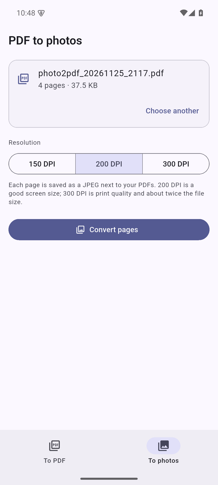

# Photo2PDF

Turn a pile of photos into one PDF — or a PDF back into photos. Runs on Android
and Linux, built with Flutter and Material 3, and does everything on the device:
nothing is uploaded anywhere.

 

## Two modes

**To PDF** — pick photos from the gallery, the file browser or the camera (or
drop them straight onto the desktop window), drag them into the order you want,
and get a single PDF.

On Linux and Windows the whole window becomes a drop target while a file is
held over it, and unsupported files are named back to you instead of silently
vanishing.

- Any format the system can decode: JPEG, PNG, WebP, BMP, HEIC, TIFF, GIF.
- **Camera** on a phone: a preview with a shutter, so pages can be shot as you
  go. Each tap adds a shot and they all arrive together on **Done**; back keeps
  what you shot. Nothing leaves the device.
- Page size **A4**, **Letter**, or **Fit image** (the page takes the photo's own
  shape); orientation **Auto**, **Vertical** or **Horizontal**.
- **Fit** or **Fill**: fit keeps the whole photo and leaves white bands where
  the shapes disagree; fill scales it up until it covers the page and crops the
  edges. Only the fixed page sizes have bands to remove.
- Margin slider from 0 to 30 mm, and a live preview of what each page will look
  like.
- Compression: **Original** keeps a JPEG byte for byte and only rewrites other
  formats; **Balanced** (~2000 px, quality 80) and **Small** (~1200 px, quality
  70) are for sharing by mail. A 4032 × 3024 test photo went 1.26 MB → 0.50 MB →
  0.13 MB.
- Optional **password** (RC4 128-bit, the standard security handler), so the
  document asks for it in any reader: `qpdf --show-encryption` reports RC4
  128-bit on a PDF made here, and the wrong password is refused.
- EXIF orientation is applied, so phone photos are never sideways.
- The output name is suggested from the photos and the time, and is made unique
  (`scan (2).pdf`) rather than overwriting.
- The PDF is built on a background isolate, so the window keeps scrolling and
  the buttons keep responding on a big set. While it works the panel shows a
  bar and `Page 5 of 12`, then `Writing the file…` — not a frozen spinner.
- The selection is kept on disk after every add, remove and reorder, so it
  survives a restart, a rotation and Android killing the app for memory. On the
  next launch a **Continue where you left off?** card offers it back, with the
  count and size, or **Start fresh** to throw it away.

**To photos** — choose a PDF, pick which pages and a resolution, and each page
comes out as a JPEG.

- **Locked PDFs** — a password-protected document asks for the password
  (again, if it is wrong) and then converts like any other. The password is
  kept in memory for that document only.
- **Pages** — leave the field empty for the whole document, or type a range
  like `1-3`, `2,5` or `1-3,7`. The line under the field says how many pages
  that is (`Will save 2 of 4 pages.`) before you press anything, and page
  numbers the document does not have are refused.

- **150 / 200 / 300 DPI** (default 200). 200 DPI gives 2338 × 1653 for an A4
  landscape page; 300 DPI is print quality at roughly twice the size.
- Pages are rendered and encoded one at a time on a background isolate, and
  each page is written before the next one starts, so a long document never
  holds all its pixels in memory and never stops the screen repainting — the
  bar and `Page 2 of 4` keep moving instead of freezing.
- Saved beside your PDFs as `holiday-page-1.jpg`, `holiday-page-2.jpg`, …

## Where files go

| | Default | Options |
|---|---|---|
| Android | `Downloads/Photo2PDF` | any folder, or ask every time |
| Linux desktop | `~/Downloads/Photo2PDF`, falling back to `~/Documents/Photo2PDF` | any folder, or ask every time |

The current selection lives in the app's own support folder, not in your
gallery: it is cleared when the list is cleared, when you choose Start fresh,
and it never leaves the device.

Settings — save folder, gallery vs. file browser vs. camera for picking, page
size, orientation, fit/fill, margin, compression — are remembered between
launches.

## Build and run

Requires Flutter 3.50 or newer. For Android you also need the Android SDK; for
the desktop build the usual Flutter Linux toolchain (clang, cmake, ninja, GTK 3).
The PDF engine ships its own binaries, so there is nothing extra to install.

```bash
flutter pub get
flutter run                     # on the connected device or desktop
flutter build apk --release     # Android APK
flutter build linux --release   # Linux bundle
```

Checks:

```bash
flutter analyze                 # no issues
flutter test                    # 78 tests
```

## Project layout

```
lib/main.dart                        app entry, starts the PDF engine
lib/src/screens/home_screen.dart     bottom bar: to PDF / to photos
lib/src/screens/converter_screen.dart      photos to PDF
lib/src/screens/pdf_to_images_screen.dart  PDF to photos
lib/src/screens/settings_screen.dart       photo source + save folder
lib/src/screens/camera_screen.dart         taking photos inside the app
lib/src/core/pdf_builder.dart        page layout, compression, PDF assembly
lib/src/core/pdf_encryption.dart     RC4 128-bit password protection
lib/src/services/                    picking, saving, rendering, settings
lib/src/widgets/                     output panel, photo card, empty state, notices
test/                                unit tests and image fixtures
PLAN.md                              scope, milestones, known limitations
```

## How it works

Building runs in an isolate of its own (`pdf_worker.dart`): the photos go across
as bytes, each finished page is reported back as a count, and the finished file
comes back as one buffer. The page callback fires from inside the builder, so
the number on screen is the page that actually exists.

Photos are decoded with the `image` package, EXIF-rotated, and laid out on an
A4/Letter page (or a page cut to the photo's shape) with the `pdf` package's
low-level objects. When the input is a JPEG and compression is Original, its
bytes are embedded untouched, so the PDF is no larger than the photos.

Passwords use the standard security handler's RC4 128-bit path, implemented
directly on the PDF objects because the `pdf` package only exposes an abstract
encryption hook — hence the one `ignore_for_file: implementation_imports`.

The other direction goes through PDFium (the `pdfrx` package): the page is
rendered into a BGRA bitmap at the requested DPI, then encoded as JPEG. PDFium
draws on pdfrx's worker isolate already, so exporting also moved the encode —
the part that used to cost a quarter of a second per A4 page on the UI isolate
— onto an isolate of its own (`page_encoder.dart`), one page at a time.

## Known limitations

- **HEIC and AVIF on the desktop build** cannot be decoded, because Skia has no
  codec for them. On Android the system decodes them normally.
- Drag-to-reorder photos, the desktop file dialogs and the drag & drop gesture
  itself need a real pointer and a display; the drop intake is unit-tested,
  but the drag is not simulated in CI.
- iOS and Windows are untested.

## Privacy

No network calls, no accounts, no analytics. Photos are read only when you pick
them and written only where you ask.
